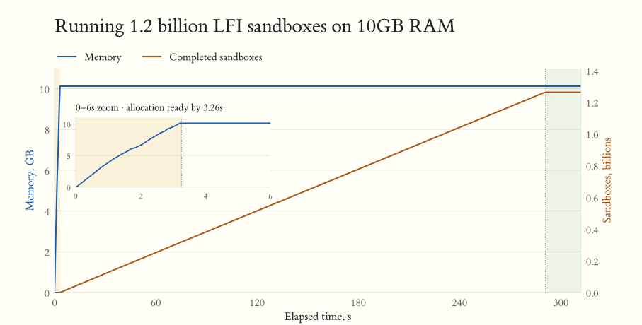
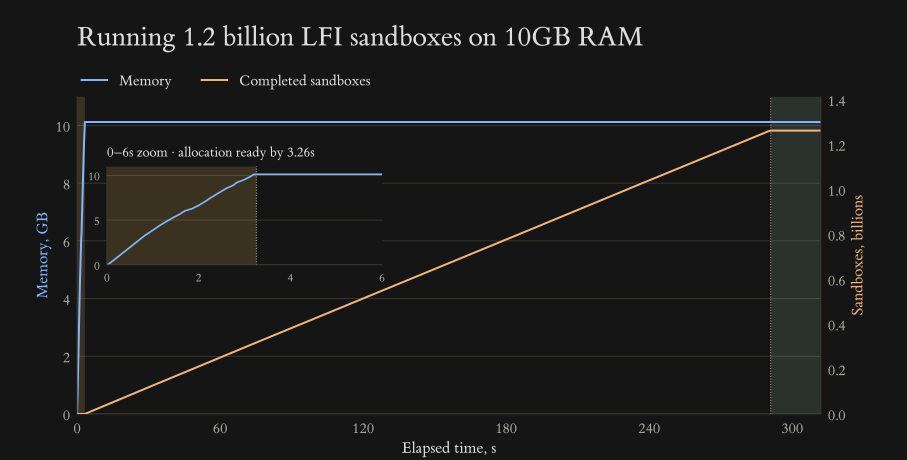

+++
title = "Running 10 million Codex CLIs on one server - LFI processes"
description = "What does it take to run millions of processes on a single host? Can we sacrifice everything and run a... billion?"
slug = "running-10-million-Codex-CLIs-on-one-server-LFI-processes"
weight = 1
date = 2026-10-21

[extra]
social_image = "@/part1_10M_process/memory-progress-social.png"
social_image_alt = "Running 1.2 billion LFI sandboxes on 10GB RAM: memory usage and completed sandboxes over time."
+++

Sitting on a toilet, I got a great idea - OpenAI spends billions on their servers; let's make them migrate to my infra instead. They have 9 million paying business users, so the business plan is:

- Run 10 million Codex CLIs without using any external services
- Our data center is a basement server with 16CPU/100GB RAM/1TB SSD
- No changes to Codex source code
- We can change dependencies - libc, tokio runtime, etc.
- We can fork Rust and rebuild anything
- We can choose OS/drivers and use our own kernel
- The main goal is, of course, money - once we reach the target, we could rent that server for 29.99$ and become rich

An experienced engineer would immediately notice that, given the constraints, the task is impossible to solve. Luckily for us, we are missing the required experience, so that blocker is solved.

## Learning is understanding

`What is heavier - light blue or false?` - is our current mental model. We know little, and even things we know we've misunderstood. An LLM has absolutely destroyed half of my brain, and yet it is the best tool for learning. Throughout the article you'll see prompts which will help you to learn. Every answer from AI will make you only more confused, and confusion is at the core of learning - keep asking. The idea is not to replace reading papers with LLM talk, but to build enough understanding with LLM talk to be able to read papers.[^noos]

[^noos]: Ubuntu is 4GB - why do we even need that?! I have my own binary; can't I just run it without an OS and save 4GB?

## 10 million processes

Global warming will kill us all in the end - let's help it by doing a warmup.

I have a hunch that it might be a little difficult to run 10 million Codex, so let's start with just 10 million empty running processes. To ensure we understand how things work, let's create an absolutely minimal running process. An empty `main` wouldn't cut it - we don't want a process to simply exit. We need the minimal process that keeps running while consuming the least amount of resources.

1. `loop {}` - 16 CPUs divided by 10M gives us `0,0000016CPU` per Codex. Plenty, but I think we should start optimising CPU from the beginning, so no busy loop
2. `thread::spawn(|| thread::sleep(Duration::MAX))` - a new thread consumes 48KB of memory; our enormous 100GB divided by 10M gives us a whopping 10KB, which is plenty for super efficient Codex, but too small for running additional threads, skip
3. `std::thread::park()` - ah, the perfection, look at that, `sleep` is 5 letters, while `park` is only 4 - 20% less RAM. For a simple Rust `fn main() { park(); }`, the produced binary is 300KB; to run it, the OS needs to load part of it into RAM, initialise kernel structs related to the new process, and then our app itself might allocate RAM for its own needs. In our example, total RAM usage is 1.73MB.

Can we do better? First, let's remind ourselves how an OS works:
```sh
$ codex "How OS runs my binaries?"
>Cloning https://github.com/torvalds/linux
>Enumerating objects: 11853083, done.
>Receiving objects: 0% (1/11853083)
^C^C
$ codex "How OS runs my binaries? SHORT. LIKE. CAVEMAN"
>Loads binary. Loads binary libs. Execute machine code. 
```
Aha, let's try to remove all the dependencies and also ensure machine code is the smallest with manual Assembly. I remember I've seen `[no_std]` mentioned in Rust deps. Let's use that - it's probably telling Rust that we do something cool and nonstandard, so we'll get some respect from the compiler and also smaller RAM usage. The following code might look scary, but essentially it is `hey oniichan kernel, please run syscall=73 and wait`:

```rust
#![no_std]
#![no_main]

#[unsafe(naked)]
#[no_mangle]
pub extern "C" fn _start() -> ! {
    /* 
    The simplest way to block a process is to call the kernel syscall ppoll 
    mov loads a syscall number and the svc/syscall instruction makes a call
    */
    #[cfg(target_arch = "aarch64")]
    core::arch::naked_asm!(
        "mov x8, #73", // Essentially syscall_num=73
        "svc #0"       // Execute syscall
    );
    /*
    For the rest of the article, I'll focus mainly on ARM, but I want you to
    appreciate how explicit the instruction for calling a syscall on x86 is
    */
    #[cfg(target_arch = "x86_64")]
    core::arch::naked_asm!(
        "mov eax, 271", // syscall number is different, but same idea
        "syscall"
    );
}

#[panic_handler]
fn panic(_: &core::panic::PanicInfo) -> ! { 
    // Required even if not used
    unsafe { core::hint::unreachable_unchecked() }
}
```

[^syscall] What is a syscall? Programs are actually free of side effects and surprisingly deterministic, and only by calling syscalls do they get access to the impure and stateful kernel and the outside world - without syscalls the only side effect our programs could have is heating up a PC box (`Good ol' days` as Haskell devs used to say before stupid monads came in and ruined all the fun). When an app runs, it constantly switches between userland (our app) and privileged kernel mode (processing syscalls), and of course the kernel might reject a syscall if it's not in a mood.

[^syscall]: Can I create a Rust toolchain which returns ENOSYS to all syscalls immediately? Would such binaries be guaranteed to be completely safe for my host system? What if I patch libc as well?

Compiling the `no_std` example gives us 70KB RAM usage (mostly from dropping the `libc` dependency) and the binary size is 968 bytes! That panic handler is annoying, though - we are quite chill and don't plan to panic even in such a restricted environment. Can we remove even that? We need an ABSOLUTE MINIMUM:


```rust
#![no_std]

#[cfg(target_arch = "aarch64")]
core::arch::global_asm!(
    ".global _start",
    "_start:",
    "mov x8, #73",
    "svc #0",
);
```

`perfection_meme.jpg` 

Ah... RAM 70KB, binary is 720 bytes. Try to beat that, John Cena! 

WAIT!

Wait, don't beat it yet! Super Mario Bros for NES was 40KB and used only 2KB of RAM. How come our essentially smallest-ever program consumes 70KB? People used to send things to space with less memory! Where did it all go?


| Name | Size | 
|---|---:|
| Kernel page tables | 28KB |
| Kernel stack | 16KB | 
| Kernel process info | 16KB |
| Kernel shadow stack | 4KB |
| Userspace RAM | 4KB | 

Not sure who all those people are, but it's obvious now why NES decided not to use Linux - kernel process overhead! Even running absolutely empty programs as an OS process will consume almost 10x our RAM budget. In theory, we could tune things and recompile the kernel to reduce overhead to something like 45KB, which is still bigger than a whole Super Mario. 

Like any other great startup, we need to pivot. In fact, OpenAI called me and asked me to change one thing. Well, it was Codex that told me to change it, but it's the same thing.

We are going to run 10M Codex inside... Minecraft.

## Sandboxes

Minecraft/Roblox/Terraria/KVM/gVisor/Docker/cat litter boxes - share a common trait of isolation: Game worlds, your binaries, and your cat's GC results are all isolated from the rest. There are two dimensions in here:

- How well things are protected from each other
- How much freedom you actually have inside such a cell

We can't run Codex without any isolation. OK, a process provides isolation, but it's rarely enough. Now let's go deeper into available sandbox solutions and see if I manage to pull off the cat's litter box analogy.

### Virtual machines

VM - essentially Minecraft in Minecraft. Here is the beautiful visualisation of how Firecracker works <https://youtu.be/-BP7DhHTU-I?t=27>. We bring another kernel and our guests run there. Having such a setup provides the biggest isolation possible (hardware enforced), but if you didn't have enough resources with one kernel, then bringing the second one is not going to save much. 

There is a beautiful concept of a unikernel (see this great example of using [Unikraft](https://unikraft.com/customer-stories/edge-functions-netlify)), which dramatically reduces the amount of overhead of a client kernel, but it still ADDS things, while we need to REMOVE things. Very nice car - but we are looking for a bus.

[^kvm]: How can a unikernel run without KVM? How can KVM run a binary without an OS?

## gVisor

Fun fact - gVisor started as a fork of Terraria; there are still some signs of it in the code base: <https://github.com/google/gvisor/blob/d4d3e28027b4b6c94848a95bb7ada24bf82be84c/pkg/sentry/kernel/syslog.go#L62-L66>
```go
		"Preparing for the zombie uprising...",
		"Feeding the init monster...",
		"Creating cloned children...",
		"Daemonizing children...",
```
[^gvisor] How does it work? gVisor uses `systrap` - when you run your app under gVisor, any `syscall` from the app will be intercepted and processed by gVisor. Essentially they wrote a userland kernel in Go which is a damn achievement! gVisor provides a virtual file system, network and everything else for each running sandbox. All syscalls are guaranteed to be captured, so `rm -rf /` will have no effect on the host itself. It's an amazing project and recently [got donated to CNCF](https://gvisor.dev/blog/2026/10/02/gvisor-cncf/) which I hope will increase its adoption. You run it like:

```sh
# runsc is the gVisor binary
$ sudo runsc do echo 'World'
>World
```
You're supposed to run one gVisor per process, so it's the same issue for us - another kernel, even if in userland, per process. Plus Go is a garbage... collecting language. Can we get programming languages flame wars back please? LLMs destroyed that vibe and now I'm forced to rage bait in the hope of hearing people who still care about our craft, sigh...

[^gvisor]: An app calling the `write` kernel syscall to save a file is risky because of kernel exploits. How does gVisor reduce the risk if, in the end, it will have to call the `write` syscall anyway to write data to disk, even if it wraps it with a bunch of additional checks and logic?

## Containers

Unix has supported running multiple processes from different users for a long time, and the OS provides a lot of isolation for them, but it's not considered enough. I cannot issue the `reboot` syscall if I don't have root permission; I cannot read another user's private key, but I can still see a lot on the host - I can see running processes, check available network devices, observe `/dev/*` files. Containers solved exactly that - the visibility.

When my process runs inside a container, then it still runs on the same machine, same kernel, same syscalls; the only difference is that it runs inside an illusion - the kernel gives it its own view of the file system (`ls /` will return files somewhere in `/var/lib/docker/overlay2/<container_id>`), its own virtual devices and network plus a few checks around, but it's still just a process sending syscalls to the same kernel. For our use case there are hardly any savings, plus in terms of isolation it's rarely trusted by the industry, so the tradeoff is not worth it for our case.

### SFI

What was the antonym for the word `security` during the Trojan War? Historical records are scarce, but very likely it was `άλογο` which roughly translates to `taking an untrusted package from the outside, bringing it home and leaving it with all the permissions`. That is exactly what is happening when you run random untrusted code INSIDE your own process.

Before you say that you've never heard about SFI, let's talk about Cloudflare workers. Reading <https://developers.cloudflare.com/workers/reference/security-model> you'll see that clients' code runs in the same process together, WAT?! Workers are running clients' code inside a host process which runs the V8 engine that provides code isolation (it's literally called [isolate](https://v8docs.nodesource.com/node-0.8/d5/dda/classv8_1_1_isolate.html) in V8) and that is probably the most popular SFI implementation in the world now. V8 plus the harness around it is basically a userland OS (V8 is also a VM, but not that VM - hope it helps) - it intercepts all IO (yep, syscalls) from the clients' code, allows/disallows things, forwards to the actual host process (yep, kernel) to perform network or disk IO and manages other resource limits.

So Software Fault Isolation is exactly about bringing untrusted packages and running them all together within a host process. Why bother? 

- Isolation - kinda should work
- Sandbox functionality - it depends, sometimes does not run Doom
- Cost - cheap as... as... cat's litter boxes! Made it!

So it looks like SFI is the cheapest isolation mechanism in terms of resources and might be the solution for our two problems: process overhead and its isolation. We would simply run only one Linux process and a bunch of SFI sandboxes inside! Which SFI to choose? V8 is quite complex and I actually didn't know that Rolls-Royce was running on JS <https://en.wikipedia.org/wiki/V8_engine>
```
>The first V8 engine used in a car was the 1905 Rolls-Royce
```

I've asked Google (they are also involved) and, after reading a bunch of papers, journals, magazines and comics, I've finally found the one - LFI (french).

## LFI

V8 allows running untrusted JS inside your process by isolating it, and so LFI allows the same but with Assembly (yep, `mov ax, bx` thingy). Your beloved C++/Rust/Swift and Brainfuck (yay!) produce Assembly as part of an LLVM build, which then produces machine code which you have in the binaries that the CPU runs.

[^asmvm]OK, LFI is not a magical VM that runs Assembly; instead it rewrites Assembly and makes it safe:

[^asmvm]: VM for assembly - that sounded so bad... or is it?

1. It splits the process address space into virtual 4GB address ranges and then rewrites Assembly to ensure that all memory operations are guaranteed to happen within that range for each sandbox
2. It replaces all syscalls with calls to our provided address in the same process that will decide what to do with the syscall

[^disassemble] Because LFI works on Assembly it means we can't take existing binaries - we need to rebuild things which is fine for us. LFI is part of LLVM already <https://llvm.org/docs/LFI.html>, free as a bird, no subscription, no account and doesn't measure things in tokens.

[^disassemble]: LFI works on Assembly; why can't I disassemble a random binary like `ls`, run LFI on the assembly and pack it back?

Here is an example in Rust, its rough representation in Assembly and the result after the LFI rewrite. Spend some time trying to understand it - it's much easier than it looks. OK, your brain is likely on the same LLM drug as mine, so you can skip it. No judgement, only sad acceptance.

<div id="lfi-code" class="code-map-source">

```rust
fn foo(ar: [i32; 2]) {
    // Memory access, read the first element
    let n = ar[0];           
    // syscall exit_group, number 94
    std::process::exit(n);   
}
```

That roughly produces the following Assembly:
```asm
; Read the first element of ar using the address in x0
ldr w0, [x0]   
; Load the exit_group syscall number, 94
mov x8, #94
; Call kernel syscall
svc #0         
```

After LFI it produces the following
```asm
/* LFI rewrites all memory access addresses
x27 is always the LFI guest base, ex. 0x21..
Valid address 0x21.. stays the same 0x21..
An invalid address 0x31.. becomes 0x21..
In the end, read the same first element from ar */
ldr w0, [x27, w0, uxtw]      
; Same, load exit_group syscall number, 94 
mov x8, #94
; New, save the return address           
mov x26, x30
; New, load the runtime gate address
ldr x30, [x27]    
; New, call  runtime instead of kernel
blr x30     
; New, restore the return address
add x30, x27, w26, uxtw      
```

</div>
<script src="code-map.js" defer></script>

Why did I burn 3 liters of tokens visualising something you successfully ignored in 3 seconds? Because that is the whole of LFI:

1. Add an additional check for all memory accesses and control flow by aligning access with the sandbox base from x27
2. Replace all syscalls with a jump to our provided function within a process

That's it, that's the whole genius of LFI: Once rewritten, our guests become isolated from each other and also pure! There is around 7% overhead in number crunching after the LFI rewrite, mostly from slowing memory reads. But besides that there is nothing else! (that's a lie) So let's run some benchmarks!

1. Let's run 100 separate processes. One process takes 70KB, so together they take 7MB of RAM. Booo, booo! 
2. LFI runs 100 of our processes within the same LFI host process. RAM usage is 15MB. YES! YES! A WIN! A negative 8MB saving! 

WAIT!

I lost... I lost?! Wait a minute, I'm not supposed to lose, let me see the script.

Where did all the RAM go?!

| Part | RAM | 
|---|---:|
| LFI runtime futex tables | 4.4MB | 
| LFI runtime callback tables | 3.2MB |
| LFI Host libraries | 1.7MB | 
| Kernel page tables | 1.6MB | 
| LFI runtime File-descriptor tables | 1.2MB |
| LFI runtime Guest ELF headers/code/data | 1.2MB |
| LFI runtime Working-directory buffers | 405KB |
| LFI runtime Guest stacks | 400KB |
| LFI runtime Syscall entry pages | 400KB |
| LFI runtime Remaining state | 336KB |

Who are all those people?! So I've lied - for LFI sandboxes to work, we also need to use <https://github.com/lfi-project/lfi-runtime/> (that is also a lie, hope my transparency makes things easier to follow): The runtime is responsible for loading guests into the host process. It provides a syscall catcher (gate). It provides some additional things on top like a virtual file system so guest1 shouldn't see files from guest2, and it also handles how guests actually run inside a process. 

Like, think about it: we've got some guest binaries, and they are pure and isolated. Now what? We need to load them into memory, probably? OK `cp /tmp/binary.exe [PID=1][Addr=0xFEE1DEAD00]`, done, what now? We have thousands if not millions of different pieces of guest code in our memory; how do we execute them? There are no threads, so if we just jump to the first guest and run it, then it might have `while True {}` and we are screwed. Should we create a thread per guest? We are screwed even harder. We have to recreate some of the kernel functionality in userland to schedule all the guests and that is what `lfi-runtime` does and that is where all the memory went.

The second lie was that LFI needs a runtime, but it doesn't NEED to be `lfi-runtime` - we can create our own, and considering the task, we were doomed to do it anyway. Just to see a theoretical limit, let's create AN ABSOLUTELY MINIMAL RUNTIME - fully tailored for our benchmark and for that benchmark ONLY - to run as many copies of our minimal process as possible. Take all possible shortcuts ever imaginable, just to pump the numbers as big as possible, to reach numbers that are not even imaginable with a general-purpose micro VM, gVisor or containers.

To follow what is happening and see that things are actually running, we would use slightly modified guest code, using assembly because we all should be Neo by now:
```asm
_start:
    mov x8, #172  ; syscall getpid() to get a PID from our runtime
    svc #0
    mov x8, #4096 ; syscall print, made up syscall number. Yep, we can do that
    svc #0
    mov x8, #73   ; syscall ppoll to block forever 
    svc #0
```
And our minimal runtime would provide an implementation for only 3 syscalls: 
- `getpid` - stub, return an index of a sandbox based on its address
- `print` - forward text to stdout via a real syscall
- `ppoll` - stub, make our runtime jump to the next guest.

That way, running guest1 will produce a side effect of printing `1` to stdout and `2` for guest2 and so on. Our runtime will run all of our guests, one by one, sequentially, yep, no threads, no stacks, no memory. Some say it's cheating - I say it's pre-IPO growth numbers. 

And here goes the result - 1.2 billion sandboxes on a 10GB RAM VM and an estimated 12 billion sandboxes for 100GB RAM (Need to send that chart to [Daytona](https://www.daytona.io) just to keep them on their toes):

<figure id="memory-progress" class="fullwidth capacity-chart">
  <picture class="chart-light">
    <source media="(max-width: 1024px)" srcset="memory-progress-mobile.svg">
    
  </picture>
  <picture class="chart-dark">
    <source media="(max-width: 1024px)" srcset="memory-progress-dark-mobile.svg">
    
  </picture>
</figure>

8 bytes per sandbox - it only contained a reference to the runtime syscall gate; all were created in 3.26s (387M/s). Running all guests took 291s (4.4M guests/s), while we spent 64% of the time in the kernel (print, yep). What does it prove? Absolutely nothing. 

What does it imply though? That LFI plus a handcrafted LFI runtime tuned for our special case of running 10M Codex is the way. There are a few things left to figure out and we are done, specifically: how to run 10M guests at the same time; how to handle interruptions; custom scheduler; threads; how to reuse memory between guests; how to compress memory; snapshot and unload guests; unload memory to disk; implement a virtual file system; virtual networking; implement hundreds of syscalls in userland and finally make a few PRs to Codex so it will run normally in the common man's 2KB of RAM.

Warmup is done. Now we can actually start working on it.

## References
- <https://github.com/artemyarulin/AI10M> main repo
- [Lightweight Fault Isolation: Practical, Efficient, and
Secure Software Sandboxing](https://www.scs.stanford.edu/~zyedidia/docs/papers/lfi.pdf)
- [Continuation-Centric Computing with Arca](https://www.usenix.org/system/files/osdi26-srivatsan.pdf)
- [Unikernels: Library Operating Systems for the Cloud](https://anil.recoil.org/papers/2013-asplos-mirage.pdf)
- [Nanvix: A Multikernel OS Design for High-Density
Serverless Deployments](https://arxiv.org/pdf/2604.11669)
- [The seL4 Microkernel](https://sel4.systems/About/seL4-whitepaper.pdf)
- [Light-Weight Contexts: An OS Abstraction for
Safety and Performance](https://www.usenix.org/system/files/conference/osdi16/osdi16-litton.pdf)
