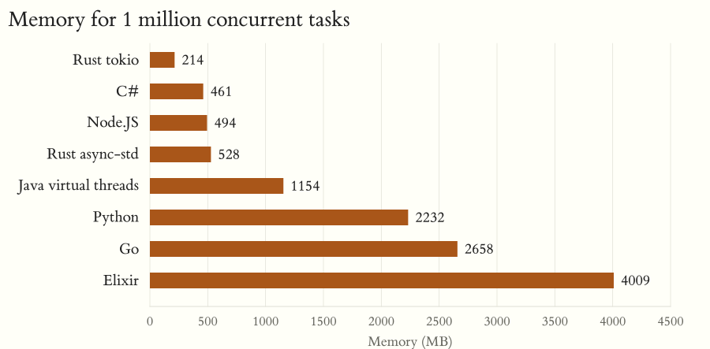
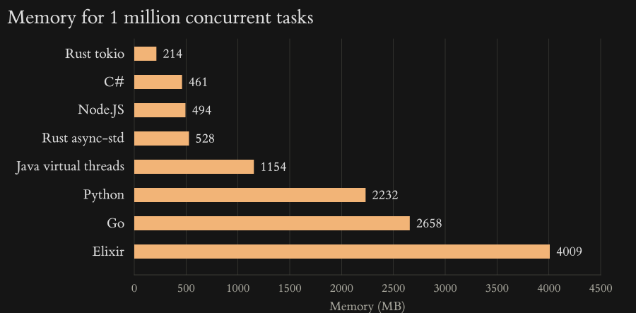

+++
title = "Userland Linux scheduler in Rust - faster than time"
description = "How can Linux run 1000 processes simultaneously on one CPU core, while just one busy loop brings Tokio to a halt?"
weight = 2
date = 2026-11-03

[extra]
social_image = "@/userland_linux_scheduler_in_rust/scheduler-social.png"
social_image_alt = "Userland Linux scheduler in Rust - faster than time. A CPU shared by the kernel, Task 1 and Task 2, with Task 1 and its context active and a timer counting down."
+++

Imagine you have a program that does pure CPU calculations with no IO:
```c
int main() {
    time_t start = time(NULL);
    do_heavy_cpu_calculations();
    printf("Completed in %.0f seconds\n", difftime(time(NULL), start));
}
```
You run thousands of those at the same time; all the cores are 100% busy. Pure CPU crunching, 100% of resources utilised, and yet the question - can we run it faster? Can we create a new userland scheduler in Rust which runs tasks more efficiently? In fact, let's make a new scheduler so efficient that programs would complete in negative time.

## What is a scheduler?

What is a kernel scheduler? Is that like Google Calendar, but a bit more granular? Let's run one app:
```console
$ time -v ./app
Completed in 61 seconds
	User time (seconds): 61.07
	System time (seconds): 0.01
	Percent of CPU this job got: 99%
	Elapsed (wall clock) time: 1:01.30
	Voluntary context switches: 1
	Involuntary context switches: 218
```
One run took a minute; it was pure CPU calculations in userland. System time is OS work. What is a context switch? The OS doesn't want one process to monopolise the CPU core forever, so even if your app is a `while true {}` busy loop, the OS scheduler will stop it now and then and give the core to another task. Here we've switched 218 times, on average once per 330ms. Let's run 10 apps simultaneously:
```console
$ parallel -j 9 ./app ::: {1..9} >/dev/null & time -v ./app 
Completed in 356 seconds
	User time (seconds): 62.96
	System time (seconds): 0.06
	Percent of CPU this job got: 20%
	Elapsed (wall clock) time: 5:56.85
	Voluntary context switches: 1
	Involuntary context switches: 36525
```
Here we see the OS scheduler's work in its prime - the user (me) requested a lot of tasks, many more than the available resources can handle. Each CPU core (the current VM has 2) can execute only one thing at a time, and yet the cursor keeps moving and music keeps playing. The scheduler constantly switches between tasks and gives the illusion that many things are working in parallel. Notice that system time is bigger - the scheduler does more work, but what exactly is the scheduler? There is no running `scheduler` process that oversees all running tasks and gives commands to others. How does it work then?

The OS cannot run by itself. Running any kernel functionality requires the same CPU as any other running process - it is not the OS telling it what things to run, but each CPU core switching between tasks, which include userland applications and kernel functionality, such as scheduling logic. Mind-blowingly, the kernel scheduler is also scheduled.

<link rel="stylesheet" href="scheduler.css">

<figure id="scheduler-animation" aria-label="A CPU sharing time between two tasks and kernel code">
{{ load_data(path="content/userland_linux_scheduler_in_rust/scheduler.svg", format="plain") | safe }}
</figure>

<script src="scheduler.js" defer></script>

Our example app got `36525` context switches across `356` seconds, on average once per 10ms - our pure (and poor) calculation got interrupted every 10ms, which is worse than in an average open space. And that is another thing that we need to understand about schedulers - interruption.

## Interruptions

Each CPU core can execute only one thing at a time, and sometimes it needs to be interrupted, but who executes that if the core is already busy? Another CPU? What if I have only one core?

Imagine I have only one CPU core. Let's write our first Tokio-based toy scheduler - set a timeout (interruption) for 5s and run our task (busy loop):

```rust
async fn run_task(seconds: u64, task: impl Future<Output = ()> + 'static) {
    // Start an interruption timer - if the task takes longer, then exit with an error
    tokio::spawn(async move {
        tokio::time::sleep(Duration::from_secs(seconds)).await;
        exit(1);
    });
    // Start a task and exit once it's done
    tokio::spawn(task).await.unwrap();
    exit(0);
}

#[tokio::main]
async fn main() {
    run_task(5, async { loop { } }).await;
}
```
Which exit code will it be - `0` or `1`? We have only one CPU core; take five seconds to think about it.

.<br>
.<br>
.<br>
.<br>
.<br>

Our only core is busy executing a task, and nothing can execute the interruption logic, so the program will never exit. How does the kernel do it then? If I rewrite our toy scheduler with `thread::spawn`, then the interruption will execute and the program will stop with an error like it should.

Each CPU core has a hardware timer which is ticking in parallel with the main execution flow. When the timer fires, the core interrupts everything and calls a kernel handler which then decides what to do. That could be scheduler code which might switch the core to execute another waiting thread instead. So is that a Tokio problem?

What the kernel does is called preemptive scheduling - any task could be interrupted and evicted at any time. Tokio uses cooperative scheduling - all tasks should do their best to not monopolise CPU cores for a long time and yield control to the runtime to give others a chance to progress. Why did they choose that? In fact, why can't they simply add a similar "hardware" timer:
```rust
fn ensure_nothing_stuck() {
    thread::spawn(|| {
        loop { 
            thread::sleep(Duration::from_milliseconds(2)); 
            interrupt_stuck_tasks(); // We've fixed tokio! 
    }})
}
```
Because, besides interruption, there is a second part of the puzzle - task context.

## Task context

It is time to reveal what our initial app was doing. Do not be afraid of Assembly; it does only two things:
1. It starts with `N^2`, then subtracts `N` exactly `N` times, producing zero in the end
2. If it doesn't produce zero - it exits with exit code 1

```asm
.global _start
_start:
    ldr  x1, =191692582605 # Big constant N
    mov  x2, x1            # Store N
    mul  x0, x1, x1        # Start at N squared
loop:
    subs x0, x0, x2        # Subtract N from x0
    sub  x1, x1, #1        # Decrement the counter
    cbnz x1, loop          # Loop if counter is nonzero
    cset w0, ne            # Set exit code to 1 if x0 is nonzero, otherwise 0
    mov  x8, #93           # Select Linux exit syscall
    svc  #0                # Execute syscall
```    
I'm giving the Assembly representation for a reason you'll get soon. The interesting part is that the app should never error:
```console
$ codex "Wanna bet 20$ this program will exit with an error code?"
If you subtract N exactly N times from N*N, then it will always be zero. Bet.
```
To understand what task context is, let's write a new, proper preemptive scheduler in userland - it simply means that our application will be switching between tasks by itself, without kernel scheduler involvement, and it will all happen inside one main thread:

```rust
struct Task {
    pc: u64, // program counter: address of an executing instruction
}

fn main() {
    let mut tasks = [
        // Our CPU number cruncher - pc points to its start address
        Task::new(number_cruncher), 
        // Another guest, simply prints 'Working' in a loop
        Task::new(print_reporter).  
    ];
    let worker = Worker::new();
    for i in (0..tasks.len()).cycle() {
        // worker.run should periodically return, so we can switch tasks
        worker.run(&mut tasks[i]); 
    }
}
```
We now have two tasks - our CPU cruncher that abuses a core for 60s and a new one which simply prints to stdout in a loop. We have only one core, and our `Worker` should support preemptive scheduling and switch between the two tasks periodically. `Worker` contains most of the logic, which is simple; the hardest part is to figure out the right `libc` calls that do all the heavy lifting. We repeat the same idea as in the OS scheduler:
1. Set and subscribe to a hardware timer which should stop and interrupt our single working thread every 2ms
2. Inside the interruption, we switch the current thread's execution address from one task to another

```rust
impl Worker {
    unsafe fn start_timer() {
        unsafe {
            // Simply subscribe to a hardware interruption every 2ms
            libc::signal(libc::SIGALRM, interrupt as usize);
            ualarm(2_000, 2_000);
        }
    }

   unsafe fn run(&self, task: &mut Task) {
        self.current.set(task);
        // enter_guest saves main’s registers and return address, 
        // then switches to the guest's saved execution address
        enter_guest(self.main_sp.as_ptr(), task.pc);
   }

    unsafe extern "C" fn interrupt(_: i32, info: *mut libc::siginfo_t, state: *mut libc::c_void) {
        // Access the interruption context
        let context = &mut (*(state as *mut libc::ucontext_t)).uc_mcontext;
        // Get a reference to the Worker that was interrupted
        let worker = &*((*info).si_value().sival_ptr as *const Self);
        // Remember where the guest stopped so we can resume it later
        (*worker.current.get()).pc = context.pc;
        // Use the way back to main saved by run()
        context.sp = worker.main_sp.get() as u64;
        // resume_main is the opposite of enter_guest from run:
        // it restores main's registers and return address, then returns from
        // enter_guest, which makes Worker::run return to our scheduling loop
        context.pc = resume_main as usize as u64;
    }
}
```
We set a hardware timer to interrupt the worker every `2ms`, run the guest, and on interruption switch back to our scheduling loop and pick another task. Let's run it:

```console
$ strace ./scheduler
write(1, "Working\n", 8) = 8
write(1, "Working\n", 8) = 8
SIGALRM {si_signo=SIGALRM, si_code=SI_TIMER, si_int=224041744}
rt_sigreturn({mask=[]})                 = 8
SIGALRM {si_signo=SIGALRM, si_code=SI_TIMER, si_int=224041744}
rt_sigreturn({mask=[]})                 = 197813463645140
write(1, "Working\n", 8) = 8
write(1, "Working\n", 8) = 8
SIGALRM {si_signo=SIGALRM, si_code=SI_TIMER, si_int=-473064688}
rt_sigreturn({mask=[]})                 = 8
exit(1)                                 = ?
+++ exited with 1 +++
```
On one hand, I'm happy to cause an existential crisis for Codex, and $20 is $20, but what went wrong - our scheduler is switching between tasks like it should, and yet our cruncher failed with an error in the end? Let's disassemble our program and execute it line by line in gdb! Update: AI told me not to do it, as it might overwhelm the readers, and instead to give them some breathing room to relax a bit. So here is the duck butt:


So what is wrong? I've ruined the suspense already - the killer is the task state. When our scheduler switches, we only preserve the `pc` address where the guest got suspended, so we can return to it later. But each guest uses much more: registers (x0-x31), the stack, flags, SIMD registers and more. The guest `reporter` pollutes the registers of `cruncher`, and that causes its self-check to fail and error with `exit(1)`. We can resolve it by storing more state for each task:
```rust
struct Task {
    pc: u64,           // program counter: address of an executing instruction
    regs: [u64; 32],   // registers x0-x30
    nzcv: u64,         // addition flags
    
    // Appreciation second - NZCV is an actual ARM term:
    // Negative,Zero,Carry,Overflow - engineering abbreviation joy, ahh
}

unsafe extern "C" fn interrupt(_: i32, info: *mut libc::siginfo_t, state: *mut libc::c_void) {
    ...
    worker.task.pc = context.pc; // new: save where the guest stopped
    worker.task.regs[..31].copy_from_slice(&context.regs); // new: save task registers
    worker.task.nzcv = context.pstate; // new: save task flags
    ...
}

```
We simply needed to store more data and store/load that whenever we switch between guests. We now have both features in our scheduler: a way to evict tasks at any time and also enough storage to preserve task context so we can actually return to it. In fact, for our guests, we don't care about a stack, but Go has a `[u8; 2048]` stack allocated for every goroutine, and that is the answer to why Go supports preemptive scheduling and Tokio cannot escape a busy loop.

Go is a stackful runtime, which I think is a misleading term. It's not only about the stack: those runtimes can evict a task at any moment because they can store all its state and continue it later on. Tokio is stackless; in theory, they could also stop execution at any random point, but they have no place to store guest state, because there is no storage preallocated for that - that is why they support switching only at yielding points, such as `async` boundaries or via a manual `tokio::task::yield_now`.

And why bother with stackless runtimes at all - aren't they worse? Piotr Kołaczkowski gave an easy-to-understand answer in [How Much Memory Do You Need to Run 1 Million Concurrent Tasks](https://pkolaczk.github.io/memory-consumption-of-async/):

<figure id="million-tasks" class="fullwidth capacity-chart">
  <picture class="chart-light">
    <source media="(max-width: 1024px)" srcset="1million-tasks-mobile.svg">
    
  </picture>
  <picture class="chart-dark">
    <source media="(max-width: 1024px)" srcset="1million-tasks-dark-mobile.svg">
    
  </picture>
</figure>

With stackless runtimes, you can fit more tasks because they consume less RAM - with Tokio it's not a big deal to have millions of tasks at the same time. Potentially, stackless runtimes can carry more tasks if you ensure that ALL of them will behave, but get only a SINGLE naughty task and a sleepless night of debugging latency and timeouts is guaranteed.

To be extra pedantic, preemptive vs cooperative scheduling and stackless vs stackful runtimes are two different dimensions, but I couldn't find any runtime with a preemptive scheduler which is ALSO stackless. And honestly, I cannot think how that could be done.

How effective is our userland scheduler? Using a VM with only one core, baseline:
```console
$ time -v parallel -j 5 ./app ::: {1..5}
	User time (seconds): 301.57
	System time (seconds): 0.31
	Percent of CPU this job got: 99%
	Elapsed (wall clock) time (h:mm:ss or m:ss): 5:03.05
	Voluntary context switches: 12
	Involuntary context switches: 302920
```
and here goes our scheduler, which runs the same 5 cruncher tasks, but all inside the same process (and thread!):
```console
$ time -v ./scheduler
	User time (seconds): 302.98
	System time (seconds): 0.26
	Percent of CPU this job got: 99%
	Elapsed (wall clock) time (h:mm:ss or m:ss): 5:04.84
	Voluntary context switches: 5
	Involuntary context switches: 2333
```
Notice how few context switches we did and also how little kernel time we used, but yet we are still slower. Why? The kernel scheduler still works; we didn't fully replace it, but it for sure does less work. The second problem comes from a timer: each tick first comes to the kernel, then it switches to our scheduler, then the `rt_sigreturn` syscall completes the timer interruption and that cancels our wins in faster switches. Can it be solved?

Linux provides a lot of scheduling tuning params; for example, `SCHED_FIFO` allows a task to monopolise the core forever. The paper [Tardis: Protected Data Plane OS Using Memory Protection Keys and Lightweight Activation](https://arxiv.org/pdf/2302.14417v2) describes a kernel module that redirects timer interrupts to a userland scheduler, avoiding the overhead of POSIX signal delivery. We are going too deep now, but I quickly prototyped both and, indeed, the scheduler could be `0.003%` faster for our specific example.

## Faster than light itself

What about the absurd claim of a negative average time that I promised in the beginning? The custom scheduler is a part of a [custom LFI runtime](/running-10-million-codex-clis-on-one-server-lfi-processes/). The important part to understand is that the runtime will intercept all the syscalls from the guests, which we can control in any way we like. So what about updating our scheduler's `Task` definition:
```rust
struct Task {
    pc: u64,           
    regs: [u64; 32],   
    nzcv: u64,         
    task_started: SystemTime, // NEW: when the task was started
    total_cpu_time: Duration, // NEW: how long the task was actually executing
}
```
Now we can measure how long each task was actually executing, and then we could do:
```rust
fn syscall_gettimeofday(task: &Task) {
    // Instead of returning real wall clock time, return adjusted time
    // based on how long the task was actually executing.
    task.task_started.add(total_cpu_time)
}
```
Now, if a task started at `00:00` and, because of too many tasks, it got only 1 minute of execution during the next hour, then it will think that the current time now is `00:01` instead of `01:00`, which I think is fair; time is relevant after all. And why use `.add` if we can use `.sub`:

```console
$ ./app-relative
Completed in -60 seconds
```

That is a nice trick, but what is the actual use of it? Going backwards will break many things. What about going forward? Our runtime controls and has access to all the information about all running tasks and running syscalls, and can implement any logic we like. Can any runtime make this program complete faster, while preserving all its guarantees and correctness?

```rust
fn main() {
    static LOCK: Mutex<()> = Mutex::new(());
    thread::spawn(|| {
        let __ = LOCK.lock();
        thread::sleep(Duration::from_secs(10));
    });
    LOCK.lock();
}
```
Our runtime can.

## References

- <https://github.com/artemyarulin/AI10M/tree/main/poc/scheduler-raw-threads> scheduler source
- [Reducing tail latencies with automatic cooperative task yielding](https://tokio.rs/blog/2020-04-preemption) great article discussing what Tokio can do and cannot do
- [The CLR Thread Pool 'Thread Injection' Algorithm](https://mattwarren.org/2017/04/13/The-CLR-Thread-Pool-Thread-Injection-Algorithm/) how to create more threads for the thread pool
- [LibPreemptible: Enabling Fast, Adaptive, and Hardware-Assisted User-Space Scheduling](https://www.csl.cornell.edu/~zhiruz/pdfs/libpreemptible-hpca2024.pdf) custom userland scheduler
- [Making Kernel Bypass Practical for the Cloud with Junction](https://www.usenix.org/system/files/nsdi24-fried.pdf) Junction, a similar runtime and scheduler
- [Shinjuku: Preemptive Scheduling for µsecond-scale Tail Latency](https://www.usenix.org/system/files/nsdi19-kaffes.pdf) Shinjuku is a single-address space operating system
- [The Benefits and Limitations of User Interrupts for Preemptive Userspace Scheduling](https://www.usenix.org/system/files/nsdi25-guo.pdf) Great overview of interrupts
- [DeCl: Deterministic and Metered Native Sandboxes](https://www.scs.stanford.edu/~zyedidia/docs/papers/decl_sib24.pdf) DeCL, a fast LFI-based runtime


